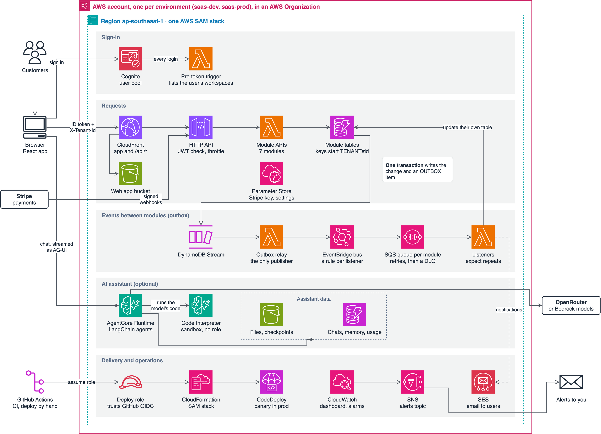

<!--
Before publishing:
- [ ] Add a sentence to the opening on why you built this, in your own words.
- [ ] Update "What it doesn't do yet" if you deploy to prod or run the workflow in a new repo. Remove only what you've actually done.
- [ ] Change the date to the day you publish, and replace the relative post links with published URLs.
-->

# A Multi-Tenant SaaS Starter on AWS: What's in It and Who It's For

Oct 30, 2026

Before a SaaS product can do anything useful, it needs workspaces, roles, invitations, billing and a way to delete a customer's data. None of that is your product, but all of it has to work.

[saas-backend-v2](https://github.com/henryonai/saas-backend-v2) is the template I built so those parts already exist, on AWS, with no servers to run. It also includes an optional AI assistant. This post covers what's in it, how it fits together, who should use it, and what it can't claim yet.

## What's included

One AWS SAM template deploys a Python backend of 7 modules, 19 Lambda functions and 8 DynamoDB tables, plus a React web app.

| Area | What you get |
| --- | --- |
| Workspaces | Several per user, with each browser tab working in its own; owner, admin and member roles; invitations by email |
| Privacy | Delete a workspace with a 7-day restore window, delete an account, and export data as a job |
| Billing | Stripe Checkout and customer portal, signed webhooks, and three sample plans with limits |
| Notifications | In-app notifications and email through Amazon SES |
| Audit log | Who did what in a workspace, kept for a year |
| Back-office | A view of every workspace for you, the operator, with plan grants and suspension |
| AI assistant (optional) | Chat agents defined in Markdown, with memory, file handling, a code sandbox and per-plan limits |
| Sample module | `orders`, a small worked example to copy for your own features, then delete |
| Web app | React, in English and Vietnamese, sharing one address with its API |
| Operations | A dashboard, 16 alarms, canary rollouts of the API in prod, and prod deploys you review before applying |

The checks run the same way for you as they do for me. There are 372 backend tests and 130 web tests that run offline, and smoke tests that make over 300 checks against a deployed stack.

## How it fits together

Requests and events take separate paths. A request is checked and answered right away, and any change it makes reaches other modules afterward, as an event.



Four decisions shape everything else, and the later posts cover each one.

1. **Modules stay separate.** No module imports another or reads another's tables, following AWS's [database-per-service pattern](https://docs.aws.amazon.com/prescriptive-guidance/latest/modernization-data-persistence/database-per-service.html). They all deploy from one stack today, so this isn't microservices, but each is built so it can move out later.
2. **Tenants share tables.** This is AWS's [pool model](https://docs.aws.amazon.com/wellarchitected/latest/saas-lens/silo-pool-and-bridge-models.html). The login token lists a user's workspaces, each request names one, and a tenant's data is keyed under its id.
3. **Events are saved with the change.** A [transactional outbox](https://docs.aws.amazon.com/prescriptive-guidance/latest/cloud-design-patterns/transactional-outbox.html) means a change can't happen without its event, or an event without its change.
4. **Limits live in the database.** Plan limits and seats are DynamoDB conditions, so two requests at the same moment can't both slip past a check.

## Who it's for

It suits you if your customers are organizations, with members and roles, and you want to own the code rather than rent a hosted backend. You should be comfortable with Python and willing to learn AWS. It also works as a learning project, because it is a whole system you can deploy and read.

Use something else if:

- **Your customers require dedicated infrastructure.** Every tenant here shares tables and functions, with no per-tenant option.
- **Your data needs relational queries.** Each module stores its data in DynamoDB, and modules can't join across each other's tables.
- **You're building for one company or for individuals.** Workspaces, roles and seats would be weight you never use.
- **You don't want to run anything on AWS.** You own the account, the alarms and the bill.

## What it doesn't do yet

This has only run on my dev stack, so treat it as a strong starting point rather than something proven in production.

- **No production use.** It has had no real customers and no load test, so I can't give you cost or performance figures. The prod deploy path and canary rollback have never run on a real prod stack.
- **A clean copy's GitHub workflow is untested.** I deployed a fresh copy to an empty AWS account from a terminal, and its smoke tests passed. I haven't yet tried the deploy workflow in a new GitHub repository.
- **Tenant isolation is in application code.** Keys and checks keep tenants apart, but there's no second layer in IAM, so a bug in a key could cross tenants. AWS describes [how to add one](https://docs.aws.amazon.com/whitepapers/latest/saas-tenant-isolation-strategies/pooled-storage-isolation-strategies.html).
- **Monitoring has gaps.** Some alarms skip the audit and admin functions, and none watches the assistant's runtime.
- **Agent quality isn't tested.** The assistant's tests use scripted models, so they show the code works, not that the answers are good.
- **Some things aren't built.** There are no trials, yearly prices, coupons or tax handling; no SSO; no customer API keys or outgoing webhooks; and no WAF. A custom domain is a manual step, and email stays off until you verify a domain in SES.

## Try it

You need an AWS account, the SAM CLI, `uv`, `pnpm` and a Stripe test account. The assistant also needs an OpenRouter key or access to Amazon Bedrock.

The template is MIT-licensed, so you can build your own product on it as long as you keep the `LICENSE` notice. Copy the repository and give it its own name, so its stacks and resources never collide with another copy:

```bash
git clone https://github.com/henryonai/saas-backend-v2 my-app && cd my-app
uv run python scripts/rename-project.py acme --title "Acme"
uv sync --all-packages && (cd web && pnpm install)
uv run pytest
```

The tests need no AWS account, so you can read the code and run them before spending anything. To deploy, follow "Starting a new project" in the [README](https://github.com/henryonai/saas-backend-v2/blob/main/README.md), which also covers Stripe and the deploy workflow.

## What's next

The next posts go from running it to building on it:

1. **[From clone to a running stack](./02-from-clone-to-a-running-stack.md):** every step, tested on a clean copy, including anything that broke.
2. **[How multi-tenancy works here](./03-how-multi-tenancy-works.md):** choosing a model, the login token and tenant keys.
3. **[Build your first module](./04-build-your-first-module.md):** copying `orders`, adding a feature, and connecting modules with events.
4. **[Add your own AI agent](./05-add-your-own-ai-agent.md):** an agent file, a tool, and how to keep it safe.

If you try it and something breaks or looks wrong, [open an issue](https://github.com/henryonai/saas-backend-v2/issues). A clean copy is the test I most want to see.
