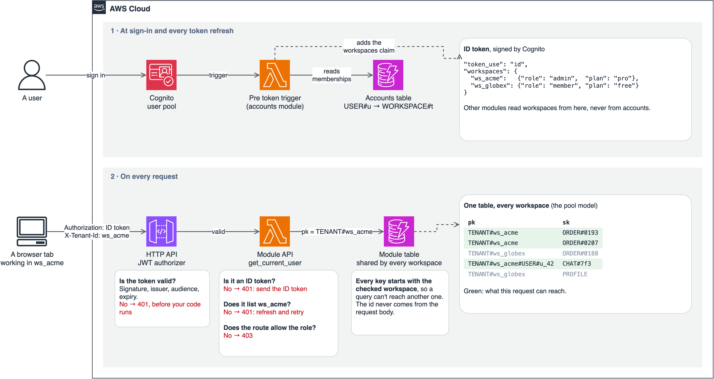

<!--
Before publishing:
- [ ] Change the date to the day you publish, and replace the relative post links with published URLs.
- [ ] Check the AWS links still work. They were read on 30 October 2026.
-->

# How Multi-Tenancy Works in a Serverless SaaS on AWS

Oct 30, 2026

In [saas-backend-v2](https://github.com/henryonai/saas-backend-v2), all customers share the same tables and functions, and two rules keep them apart. The login token decides which workspaces a user may act in, and each workspace's data is stored under its own id.

This post explains when you need multi-tenancy, how to choose a model, how to implement it, and where this approach is still weak. If you're new here, start with [what's in the template](./01-whats-in-the-template.md).

## Do you need it?

You need multi-tenancy when one product serves many customer organizations and each must see only its own data. An internal tool for one company doesn't need it, and neither does an app where each person only sees their own data. That's my rule of thumb, not AWS's.

In this template, a tenant is a **workspace**. One user can belong to several, and each browser tab can work in a different one.

## Choose a model

AWS describes [three models](https://docs.aws.amazon.com/wellarchitected/latest/saas-lens/silo-pool-and-bridge-models.html), and you can choose differently for each service.

| Model | What it means | Choose it when | What it costs you |
| --- | --- | --- | --- |
| Silo | Each tenant gets dedicated resources | [Strict compliance, noisy-neighbor worries or per-tenant cost tracking](https://docs.aws.amazon.com/wellarchitected/latest/saas-lens/silo-isolation.html) | Higher cost, heavier onboarding and decentralized management |
| Pool | Tenants share resources | You want economies of scale and simple operations | [Isolation is harder and needs extra care](https://docs.aws.amazon.com/whitepapers/latest/saas-tenant-isolation-strategies/pool-isolation.html) |
| Bridge | Some services silo, others pool | Services differ in data rules or load | Two models to operate (my reading, not AWS's) |

This template pools everything, which suits small and mid-sized customers. [AWS's DynamoDB guidance](https://aws.amazon.com/blogs/apn/partitioning-pooled-multi-tenant-saas-data-with-amazon-dynamodb/) describes the same trade: easier management, in exchange for more concern about noisy neighbors and security.

## Logging in is not isolation

This is the idea to hold on to. [AWS is explicit](https://docs.aws.amazon.com/whitepapers/latest/saas-architecture-fundamentals/tenant-isolation.html) that an authenticated, authorized user could still reach another tenant's data unless every access is scoped to the current tenant. A valid token proves who someone is, not what they may touch.

So every request here goes through the same decision before any data is read.



## Implement it in five steps

### 1. Put the tenants in the token

A [pre token generation trigger](https://docs.aws.amazon.com/cognito/latest/developerguide/user-pool-lambda-pre-token-generation.html) runs at every login and refresh. It adds a `workspaces` claim listing each workspace with the user's role and the plan, so other modules never have to ask the accounts module.

```python
# modules/accounts/src/accounts/service.py
workspaces = {tenant.tenant_id: {"role": member.role, "plan": tenant.plan}
              for tenant, member in self.accounts.workspaces_of(user_id) if tenant.active}
return {WORKSPACES_CLAIM: json.dumps(workspaces, separators=(",", ":"))} if workspaces else {}
```

### 2. Verify the token before your code runs

A [JWT authorizer](https://docs.aws.amazon.com/apigateway/latest/developerguide/http-api-jwt-authorizer.html) on the HTTP API checks the signature, issuer, audience and expiry, then passes the claims to Lambda. One route has no JWT check: the Stripe webhook, which has no user and verifies Stripe's signature instead.

### 3. Resolve the tenant in one function

The request names a workspace, and the token decides whether it may. Every module API route gets its caller from `get_current_user`, so this logic exists in one place.

```python
# layers/shared/layer/shared/auth.py
if claims.get("token_use") != "id":
    raise Unauthorized("Send the ID token in the Authorization header")
workspaces = workspaces_in(claims)
workspace = workspaces.get(tenant_id) if tenant_id else None
if tenant_id and not workspace:
    raise Unauthorized("Your token doesn't list this workspace; refresh it and try again")
```

The first check matters because the authorizer can't tell token types apart, and only ID tokens carry the `workspaces` claim. AWS's [authorizer page](https://docs.aws.amazon.com/apigateway/latest/developerguide/http-api-jwt-authorizer.html) notes that there is no standard way to distinguish them.

### 4. Start every tenant item's key with the tenant

A query on a tenant's key can't reach another tenant's partition. HTTP request schemas never contain `tenant_id`, so a client can't supply a different one in the body. Lookups and system records, such as `USER#` and `OUTBOX#`, use other keys.

```python
# modules/orders/src/orders/repository.py
def _pk(tenant_id: str) -> str:
    return f"TENANT#{tenant_id}"

item = {"pk": _pk(order.tenant_id), "sk": f"ORDER#{order.order_id}", **order.model_dump(mode="json")}
```

### 5. Enforce limits in the database

A plan limit checked by reading first can be beaten by two requests at the same moment. [DynamoDB transactions](https://docs.aws.amazon.com/prescriptive-guidance/latest/modernization-rdbms-dynamodb/overview.html) can check a condition and write atomically, so the check and the write can't be separated.

```python
# modules/orders/src/orders/repository.py
counter["ConditionExpression"] = "attribute_not_exists(order_count) OR order_count < :max"
```

## The catch: tokens go out of date

A token is a snapshot from when it was issued. ID tokens here last 15 minutes, so for any change, ask when it takes effect.

| What changed | Where it's enforced | When it takes effect |
| --- | --- | --- |
| Role or membership, for the accounts module's own actions | Accounts re-reads its table | At once. A role change or removal by someone else also revokes refresh tokens |
| Role, in other modules | The token | Within 15 minutes |
| Workspace suspended or being deleted | Accounts' own record, and a status copy in orders, billing and the assistant | Seconds, as the event arrives |
| Plan | The token | At the next token refresh |
| Joined a new workspace | The token | 401 until the client refreshes |

The third row was a real gap. A suspended workspace stayed in members' tokens for up to 15 minutes, so a token issued before the suspension could still add an order. Now each module keeps its own copy of the workspace's status, updated by events, and [refuses changes at once](https://github.com/henryonai/saas-backend-v2/commit/621aa60).

## Prove it with a test

Isolation is only worth claiming if a test fails when it breaks. The orders module tests it directly:

```python
# modules/orders/tests/test_api.py
def test_tenants_cannot_see_each_others_orders(ctx, alice):
    _, order = ctx.api("POST", "/orders", alice, ORDER)
    zoe = claims("zoe", "t2", "owner")
    assert ctx.api("GET", f"/orders/{order['order_id']}", zoe)[0] == 404
    assert ctx.api("GET", "/orders", zoe)[1]["items"] == []
```

The smoke test also checks isolation with real users against a deployed stack.

## Where this is still weak

**Isolation lives only in application code.** AWS shows [IAM leading-key conditions](https://docs.aws.amazon.com/whitepapers/latest/saas-tenant-isolation-strategies/pooled-storage-isolation-strategies.html) that limit a request's credentials to one tenant's items, and this template doesn't use them. A bug in a key could cross tenants, and nothing below the code would stop it. Add them if your customers need that assurance.

**One user pool is a trade-off.** I use one because a person can join several workspaces with one login. [A pool per tenant](https://docs.aws.amazon.com/cognito/latest/developerguide/bp_user-pool-based-multi-tenancy.html) gives the most isolation, but each user signs up separately for each tenant and the effort is high. Either way, within one account, [Cognito's quotas are shared by all tenants](https://docs.aws.amazon.com/cognito/latest/developerguide/multi-tenant-application-best-practices.html).

**There's no per-tenant rate limit.** The API's throttle of 50 requests a second covers everyone, so one busy tenant can affect the others.

Next, [build your first module](./04-build-your-first-module.md) on top of these rules.
