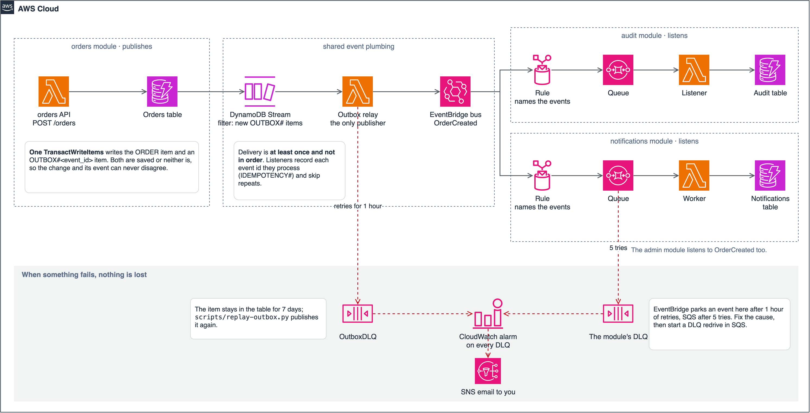

<!--
Before publishing:
- [ ] Change the date to the day you publish, and replace the relative post links with published URLs.
- [ ] Check the AWS links still work. They were read on 30 October 2026.
- [ ] If you deploy the tickets example, update "What I tested" and remove the sentence saying it wasn't deployed.
-->

# Build Your First Module: Copy, Change and Connect with Events

Oct 30, 2026

A module in [saas-backend-v2](https://github.com/henryonai/saas-backend-v2) is a folder that owns its tables, routes and workers, and never imports another module. The quickest way to build one is to copy the `orders` sample.

This post builds a `tickets` module that way, adds a feature to it, and uses an event to make another module react. I ran these steps on a clean copy, and they turned up four traps that the checks don't catch.

## How modules are organized

Each file has one job, which is what lets you change one part without touching the rest.

| File | Its job |
| --- | --- |
| `models.py` | What the module stores |
| `schemas.py` | What its HTTP API accepts and returns |
| `repository.py` | The only code that touches its table |
| `service.py` | The business rules, with dependencies passed in |
| `events.py` | The events it publishes: its public contract |
| `container.py` | Builds the real clients and reads settings |
| `api.py`, `handler.py` | The routes, and the Lambda entry point |
| `listener.py` | Reacts to other modules' events |

This follows AWS's [database-per-service pattern](https://docs.aws.amazon.com/prescriptive-guidance/latest/modernization-data-persistence/database-per-service.html), though all modules still deploy from one stack.

## Step 1: Copy and rename

Work on a branch. This keeps the sample in place, so you can compare against it.

```bash
cp -R modules/orders modules/tickets
mv modules/tickets/src/orders modules/tickets/src/tickets
find modules/tickets -name __pycache__ -type d -prune -exec rm -rf {} +
find modules/tickets -type f \( -name '*.py' -o -name '*.toml' \) -exec perl -pi -e \
  's/orders/tickets/g; s/Orders/Tickets/g; s/ORDERS/TICKETS/g; s/order/ticket/g; s/Order/Ticket/g; s/ORDER/TICKET/g' {} +
uv sync --all-packages
```

The module now has a ticket with the order's fields (`item`, `quantity`, `price_cents`). You'd replace those with your own, but keep them for now, so the copied tests still apply.

## Step 2: Add its plan limit

Run the tests:

```bash
uv run pytest modules/tickets
```

17 of the 29 tests fail with `KeyError: 'max_tickets'`. The rename also renamed the plan limit, and the plan catalog doesn't have that one yet. Add it to each plan in `layers/shared/layer/shared/plans.py`:

```python
"free": {"name": "Free", "price_usd_month": 0, "max_users": 3, "max_orders": 100, "max_tickets": 100,
```

Use `"max_tickets": 10_000` for Pro and `None`, meaning unlimited, for Business. All 29 tests now pass.

Notice that the limit needed no new code: the DynamoDB condition you copied already enforces it.

## Step 3: Add it to the template

Copy everything in `template.yaml` from the `Module: orders` heading down to the `Module: audit` heading, and paste it above `Module: audit`. In the copy, replace `orders` with `tickets`, keeping each word's capitalization, so `OrdersTable` becomes `TicketsTable` and `/orders` becomes `/tickets`. Replace `order` with `ticket` too.

That one section gives you the table, the API function and routes, the listener, its queue, its dead-letter queue and an alarm.

**Trap 1: events go nowhere until you connect the stream.** The relay that publishes events is outside that section, so your module would save events that are never sent. Nothing fails, and every check still passes. Add your table to `OutboxRelayFunction`'s `Events`, copying the `Orders` entry:

```yaml
Tickets:
  Type: DynamoDB
  Properties:
    Stream: !GetAtt TicketsTable.StreamArn
    StartingPosition: TRIM_HORIZON
    BatchSize: 50
    FunctionResponseTypes: [ReportBatchItemFailures]
    BisectBatchOnFunctionError: true
    MaximumRetryAttempts: -1
    MaximumRecordAgeInSeconds: 3600
    DestinationConfig: { OnFailure: { Type: SQS, Destination: !GetAtt OutboxDLQ.Arn } }
    FilterCriteria:
      Filters: [{ Pattern: '{"eventName": ["INSERT"], "dynamodb": {"Keys": {"pk": {"S": [{"prefix": "OUTBOX#"}]}}}}' }]
```

**Trap 2: the alarms and dashboard don't know about you.** The shared alarms and the dashboard list functions by name. Search `template.yaml` for `OrdersApiFunction` and `OrdersListenerFunction`, and add your functions wherever they appear outside your section. Your canary rollback and duration alarms depend on it.

## Step 4: Add a feature

Let's add a priority to tickets. Features follow the same path each time.

First, the stored shape, in `models.py`:

```python
class TicketPriority(StrEnum):
    NORMAL = "normal"
    HIGH = "high"


class Ticket(BaseModel):
    ...
    priority: TicketPriority = TicketPriority.NORMAL  # tickets saved before this field read as normal
```

Next, what the API accepts, in `schemas.py`:

```python
class TicketCreate(BaseModel):
    ...
    priority: TicketPriority = TicketPriority.NORMAL
```

Then the rule, in `service.py`. Copy fields across explicitly, so a new request field can't be stored by accident:

```python
ticket = Ticket(tenant_id=tenant_id, created_by=user.user_id,
                item=data.item, quantity=data.quantity, price_cents=data.price_cents,
                priority=data.priority)
```

Then test it, including the case people forget: items stored before this change existed.

```python
def test_a_ticket_saved_before_priority_existed_reads_as_normal(ctx, alice):
    _, ticket = ctx.api("POST", "/tickets", alice, TICKET)
    ctx.table.update_item(Key={"pk": "TENANT#t1", "sk": f"TICKET#{ticket['ticket_id']}"},
                          UpdateExpression="REMOVE priority")
    assert ctx.api("GET", f"/tickets/{ticket['ticket_id']}", alice)[1]["priority"] == "normal"
```

That's the rule whenever stored items change shape: decide how old items are read or backfilled. Here the default handles it, so no backfill is needed.

A new route would also go in `api.py`, and in `template.yaml` if its method and path aren't covered yet. Routes there are per method, so `POST /tickets/{id}/close` needs an entry even though `GET /tickets/{proxy+}` exists.

## Step 5: Tell other modules with an event

Modules never call each other's code, so choose how to share information by what the caller needs.

| You need | Use | Example |
| --- | --- | --- |
| Facts about the caller | The login token | Reading the plan to check a limit |
| To say something happened | An event | `TicketCreated`, which others can react to |
| To act for the user, right now | The public HTTP API, with the user's token | The assistant's tools |

Your copied module already publishes `TicketCreated`, because the repository saves it in the same transaction as the ticket. That's the [transactional outbox pattern](https://docs.aws.amazon.com/prescriptive-guidance/latest/cloud-design-patterns/transactional-outbox.html): a change can't happen without its event, or an event without its change.



```python
# modules/tickets/src/tickets/repository.py
transact(
    self.table,
    limit={"Update": counter},
    ticket={"Put": {"Item": item, "ConditionExpression": "attribute_not_exists(pk)"}},
    event=outbox_put(event),
    idempotency=idempotency_put(_pk(ticket.tenant_id), ticket.created_by, *idempotency, ticket.ticket_id),
    active=active_condition(self.table, ticket.tenant_id),
)
```

To make notifications react, make two changes. Add a handler in `modules/notifications/src/notifications/service.py`:

```python
def _on_ticket_created(self, d: dict) -> None:
    self._in_app(d, d["user_id"], "Ticket created", f"Your ticket for {d['item']} was created.")

HANDLERS = {
    "OrderCreated": _on_order_created,
    "TicketCreated": _on_ticket_created,
    ...
}
```

And add the event to `NotificationsRule` in `template.yaml`, so it reaches the queue at all:

```yaml
detail-type: [OrderCreated, TicketCreated, UserInvited, SubscriptionChanged, PaymentFailed, MemberRemoved, TenantDeleted, ExportRequested, ExportReady]
```

Test it the way a real delivery arrives:

```python
def test_ticket_created_becomes_in_app_notification(ctx):
    ticket = with_event_ids({"tenant_id": "t1", "user_id": "alice", "ticket_id": "x1", "item": "Printer"})
    assert ctx.deliver("TicketCreated", ticket) == {"batchItemFailures": []}
    assert notes(ctx)[0]["title"] == "Ticket created"
```

Events can arrive twice or out of order, because [EventBridge delivers at least once](https://aws.amazon.com/documentation-overview/eventbridge/). When you write a listener, ask what happens if the event arrives twice, and what happens if it arrives after a newer one.

**Trap 3: new modules aren't in exports or the audit log.** Your listener writes its part of a workspace's export, but accounts only waits for the parts it lists. Add `"tickets"` to the list in `modules/accounts/src/accounts/service.py`, and update `test_exports.py`, which checks that list. To log the event in the audit trail, add it to `AUDITED` in `modules/audit/src/audit/service.py` and to `AuditRule`.

**Trap 4: `gen:api` changes more than you'd expect.** It adds your module's types, and it also changes the web app's copy of the plans, because you added a limit. Commit both, or CI fails.

## Step 6: Run every check

```bash
./scripts/export-requirements.sh
uv run pytest
./scripts/export-requirements.sh --check
uvx ruff check .
uvx cfn-lint template.yaml .github/deploy-role.yaml
(cd web && pnpm gen:api && pnpm typecheck && pnpm lint && pnpm test && pnpm build)
```

Then deploy to dev, as in [the deploy post](./02-from-clone-to-a-running-stack.md). Before you add real features, replace the copied `item`, `quantity` and `price_cents` fields, and add your module's pages under `web/src/features/`. Once you no longer need the sample, the README's "The sample module" section lists everything to remove.

## What I tested

I ran this on a clean clone at commit `31da65a`, except the alarm and dashboard edits in Trap 2 and the audit change in Trap 3. I tried the export change only far enough to confirm that `test_exports.py` needs updating. With the module, the priority feature and the notification in place, plus the agent from the next post, the backend suite grew from 372 to 405 tests and all passed. Lint, the template check and all 130 web tests passed too, and the web app built.

I didn't deploy this example, so the stream connection in Trap 1 has only been checked by the template linter, not by a real event. Run the smoke test on your own module's routes after you deploy.

Next, [add your own AI agent](./05-add-your-own-ai-agent.md).
