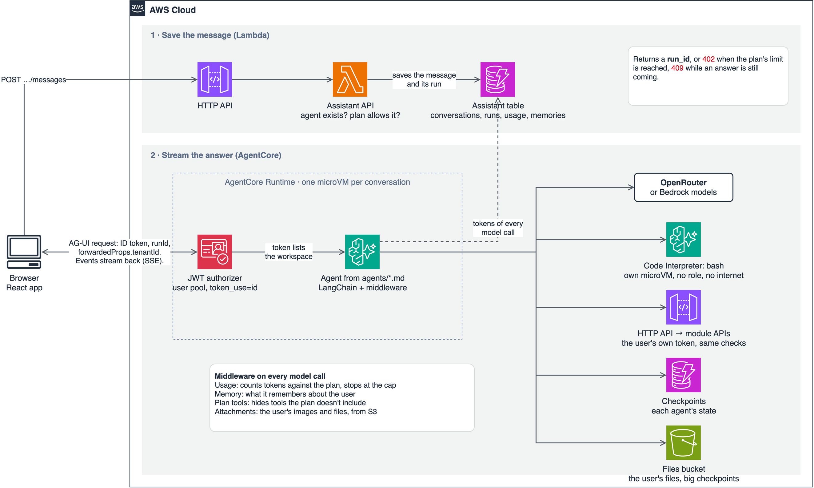

<!--
Before publishing:
- [ ] Change the date to the day you publish, and replace the relative post links with published URLs.
- [ ] Check the AWS links still work. They were read on 30 October 2026.
- [ ] If you deploy the support agent and try it with a real model, update "What I tested".
-->

# Add Your Own AI Agent to a Multi-Tenant SaaS

Oct 30, 2026

An agent in [saas-backend-v2](https://github.com/henryonai/saas-backend-v2) is a Markdown file: its header picks the tools and model, and its body is the system prompt. You can add one without writing Python, unless it needs a new tool.

This post adds a `support` agent and a tool it needs, then covers how it's hosted and how to keep it safe. The hard part of an agent in a multi-tenant product isn't the prompt. It's making sure the agent can never do more than the person using it.

## How it fits together

Agents don't run on Lambda. [AgentCore Runtime](https://docs.aws.amazon.com/bedrock-agentcore/latest/devguide/runtime-agui.html) hosts them, LangChain runs them, and AG-UI events stream each answer to the browser. The assistant module is optional, so a stack can run without it.

A message takes three steps:

1. The browser posts it to the HTTP API. A Lambda checks the plan's limits, saves the message and returns a `run_id`.
2. The browser calls the runtime directly with the ID token and that run. It names the workspace in `forwardedProps.tenantId`, because AgentCore passes on no custom headers. The same rule applies as everywhere else: the token must list that workspace.
3. The agent runs and streams its answer. Each model call's tokens count against the plan, and the run stops at the cap.



## Step 1: Write the agent

Create `modules/assistant/src/assistant/agents/support.md`:

```markdown
---
name: support
description: Answers questions about the workspace's recent notifications and orders. Use when the user asks what happened recently.
tools: list_notifications, list_orders, get_order
model: inherit
maxTurns: 8
---
You help one signed-in user understand what happened recently in their workspace, working for another agent.

Read their notifications and orders with your tools, then return a short summary of what changed. If your tools don't show something, say so instead of guessing.
```

The `description` matters more than it looks, because the calling agent reads it to decide when to delegate. `model: inherit` uses the stack's model, set by `AssistantModelId`. `maxTurns` bounds how many model calls one run can make, and so what it can cost.

To let the main agent delegate to it, add it to `subagents` in `agents/assistant.md`:

```markdown
subagents: analyst, support
```

A subagent starts fresh with only its own prompt and the task it was given. It works for the same user, and it can't delegate further.

Only add an agent for focused, multi-step work. For a few extra instructions, a longer system prompt is cheaper, because each subagent costs a fresh model context.

## Step 2: Add the tool it needs

`list_orders` and `get_order` already exist, but `list_notifications` doesn't. Create `modules/assistant/src/assistant/tools/notifications.py`:

```python
from langchain.tools import ToolRuntime, tool
from langchain_core.tools import BaseTool

from assistant.context import AgentContext
from assistant.tools.orders import AppApi


def make_notification_tools(api: AppApi) -> list[BaseTool]:
    @tool(description="List the signed-in user's recent notifications in this workspace, newest first.")
    def list_notifications(runtime: ToolRuntime[AgentContext]) -> dict | list:
        return api.get(runtime.context.authorization, runtime.context.user.tenant_id, "/notifications")

    return [list_notifications]
```

Then import it in `tools/__init__.py` and add it to `make_tools`:

```python
from assistant.tools.notifications import make_notification_tools

tools = [*make_order_tools(api), *make_notification_tools(api), make_usage_tool(usage),
         make_bash_tool(sandbox, usage),
         *make_memory_tools(memories), *make_file_tools(files, sandbox, usage)]
```

This short tool shows the four rules for every tool here:

- **Use the public API with the user's token.** The tool doesn't read the notifications table. It calls `/notifications` as the user, so the API's tenant and role checks still apply, and the agent can never do more than the user could.
- **Keep the token away from the model.** It reaches the tool through `runtime.context`, and never appears in a prompt.
- **Return errors as data.** `api.get` returns `{"error": ...}`, so the model can explain a failure instead of the whole message failing.
- **Be careful with tools that change data.** A retried run can call a tool twice, so it needs an idempotency key, and usually the user's approval. No tool changes another module's data today, which is why this one only reads.

## Step 3: Test it

```bash
uv run pytest modules/assistant
```

A missing field, an unknown tool or a bad model fails here and at the agent's startup, not in a user's conversation.

**The trap: two existing tests will fail, and that's expected.** They list the shipped agents exactly, so that adding one is a deliberate act. Update them:

```python
# modules/assistant/tests/test_definitions.py
TOOLS = {"list_orders", "get_order", "list_notifications", "assistant_usage", "bash", "write_file", "save_file",
         "open_file"}
assert set(agents) == {"assistant", "analyst", "support"}
assert agents["assistant"].subagents == ("analyst", "support")

# modules/assistant/tests/test_container.py
assert set(agents) == {"assistant", "analyst", "support"}
```

Then add a test for your agent. The test suite uses a scripted model, so you can check what the tool does without spending anything:

```python
# modules/assistant/tests/test_agent.py
def test_the_support_agent_reads_notifications_with_the_users_token(ctx, alice):
    ctx.api.responses["/notifications"] = [{"title": "Order created", "read": False}]
    ctx.script(ctx.tool_call("list_notifications", {}), ctx.answer("One order was created."), agent="support")

    events = ctx.chat("What happened?", alice, agent="support")

    assert ctx.tools(events) == ["list_notifications"]
    [call] = ctx.api.calls
    assert call["path"] == "/notifications" and call["authorization"].startswith("Bearer ")
```

**A scripted model can't tell you whether the agent is any good.** These tests prove the plumbing works, not that the answers are right. To try it with a real model before you deploy, the [assistant README](https://github.com/henryonai/saas-backend-v2/blob/main/modules/assistant/README.md) explains how to run it locally against your dev stack.

## Step 4: Deploy it

The deploy workflow packages the agent code for you. From a terminal, pass the location of the zip:

```bash
sam deploy --config-env dev \
  --parameter-overrides "$(uv run python scripts/package-assistant.py --config-env dev)"
uv run scripts/smoke-assistant.py --stack saas-dev   # costs a few cents of model tokens
```

The runtime is declared in `template.yaml`. This part sets the protocol and accepts only this user pool's ID tokens:

```yaml
AssistantRuntime:
  Type: AWS::BedrockAgentCore::Runtime
  Properties:
    ProtocolConfiguration: AGUI
    AuthorizerConfiguration:
      CustomJWTAuthorizer:
        DiscoveryUrl: !Sub https://cognito-idp.${AWS::Region}.amazonaws.com/${UserPool}/.well-known/openid-configuration
        AllowedAudience: [!Ref UserPoolClient]
        CustomClaims:
          - InboundTokenClaimName: token_use
            InboundTokenClaimValueType: STRING
            AuthorizingClaimMatchValue:
              ClaimMatchOperator: EQUALS
              ClaimMatchValue: { MatchValueString: id }
```

## Keep it safe

AWS's [security best practices for AgentCore Runtime](https://docs.aws.amazon.com/bedrock-agentcore/latest/devguide/runtime-security-best-practices.html) include some warnings that are easy to miss. This is how the template responds to them.

| AWS says | What this template does |
| --- | --- |
| AgentCore doesn't enforce session-to-user mappings, so your backend must | Thread and sandbox keys include the user, and a run checks its owner, so another user's session id reaches only your own data. The request can still land in that session's microVM |
| Code inside the microVM can read the execution role's credentials | The model's commands run in a separate [Code Interpreter](https://docs.aws.amazon.com/AWSCloudFormation/latest/TemplateReference/aws-resource-bedrockagentcore-codeinterpretercustom.html) sandbox, with no role and, by default, no internet |
| Configure every JWT validation field | Sets the discovery URL, the audience and a required `token_use` claim, but no client or scope lists |
| Scope what the runtime's role can do | Scoped to its own tables and buckets, except that it may call any foundation model, because an agent's file can name one |

Set limits too, because a model will use whatever you give it. Each plan has an hourly message limit and a monthly token cap, enforced by DynamoDB conditions, and `maxTurns` bounds each run.

## What this doesn't cover yet

- **No guardrails.** The browser calls the runtime directly, with no [AgentCore Gateway](https://docs.aws.amazon.com/bedrock-agentcore/latest/devguide/runtime-security-best-practices.html) in front. AWS describes a gateway as a common pattern for adding policies and guardrails.
- **No approval flow.** Agents can't yet ask a user before changing data, so tools that change another module's data aren't safe to add.
- **No evaluation.** Nothing checks answer quality before a prompt change ships, so a worse agent would reach users first.
- **No alarm on the runtime.** Failures there don't reach `ApiErrorsAlarm`, because chat doesn't pass through the HTTP API.

## What I tested

I ran these steps on a clean clone at commit `31da65a`. With the agent, the tool and the updated tests in place, the assistant's tests passed, including the new one, and so did lint. I didn't deploy this agent or try it with a real model, so its answers are untested. Your first real run is where you'll learn whether the prompt works.
