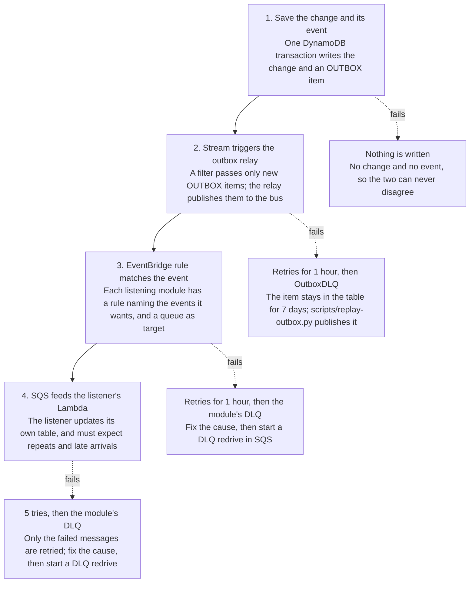

# How to Build a Multi-Tenant SaaS on AWS

Oct 30, 2026

This guide shows how to build a multi-tenant SaaS on AWS using the patterns in [saas-backend-v2](https://github.com/henryonai/saas-backend-v2): shared-table tenancy, self-contained modules, event-driven communication and AI agents.

The code samples come from the repository at commit `ffb403e`. Every AWS link goes to a page read for this guide, and the second-to-last section says where this code differs from AWS's advice. To run the system, see the [operations runbook](./operations-runbook.md).

## Technology

Everything is serverless and defined in one [AWS SAM](https://docs.aws.amazon.com/serverless-application-model/latest/developerguide/automating-updates-to-serverless-apps.html) template, so there are no servers to run and idle cost stays low.

| Layer | Technology | What it does here |
| --- | --- | --- |
| API | API Gateway HTTP API | Checks the login token, then routes to Lambda |
| Compute | Lambda, Python 3.13 on arm64, Powertools | Runs each module's API and workers |
| Identity | Cognito user pool, pre token generation trigger | Signs users in and lists their workspaces in the token |
| Data | DynamoDB, one or more tables per module | Stores all tenants' data in shared tables |
| Events | DynamoDB Streams, EventBridge, SQS | Carries changes from one module to others |
| Agents | AgentCore Runtime and Code Interpreter, LangChain, AG-UI | Runs the assistant and its sandbox, and streams answers |
| Models | OpenRouter or Amazon Bedrock | Set by `AssistantModelId` or an agent's own file |
| Web app | React 19, Vite, TanStack Router and Query, Amplify, S3, CloudFront | Serves the app and its API on one address |
| Payments | Stripe | Handles checkout and subscriptions |
| Delivery | GitHub Actions with OIDC, CodeDeploy canaries | Deploys without stored AWS keys; prod's API functions roll out gradually |
| Developer tools | uv, pytest with moto, ruff, cfn-lint | Runs the tests offline and checks the code |

## Step 1: Apply multi-tenancy

Use multi-tenancy when one product serves many customer organizations and each must see only its own data. An internal tool for one company, or an app where each person only sees their own data, doesn't need it. That rule of thumb is our judgment, not AWS's. Here a tenant is a workspace, and one user can belong to several.

### Choose a model

AWS describes [three models](https://docs.aws.amazon.com/wellarchitected/latest/saas-lens/silo-pool-and-bridge-models.html), and you can choose differently for each service.

| Model | What it means | Choose it when | Cost of choosing it |
| --- | --- | --- | --- |
| Silo | Each tenant gets dedicated resources | [Strict compliance, noisy-neighbor worries or per-tenant cost tracking](https://docs.aws.amazon.com/wellarchitected/latest/saas-lens/silo-isolation.html) | Higher cost, heavier onboarding and decentralized management |
| Pool | Tenants share resources | You want economies of scale and simple operations | [Isolation is harder and needs extra care](https://docs.aws.amazon.com/whitepapers/latest/saas-tenant-isolation-strategies/pool-isolation.html) |
| Bridge | Some services silo, others pool | Services differ in data rules or load | Two models to operate (our reading, not AWS's) |

This repository pools everything. All workspaces share each table, which suits a template for small and mid-sized customers. [AWS's DynamoDB guidance](https://aws.amazon.com/blogs/apn/partitioning-pooled-multi-tenant-saas-data-with-amazon-dynamodb/) describes the same trade: easier management, more noisy-neighbor and security concern.

### Know what isolation is

Logging in is not isolation. [AWS is explicit](https://docs.aws.amazon.com/whitepapers/latest/saas-architecture-fundamentals/tenant-isolation.html) that an authenticated, authorized user could still reach another tenant's data unless you scope every access to the current tenant. The steps below do that.

### Implement it

1. **Put tenants in the token.** A [pre token generation trigger](https://docs.aws.amazon.com/cognito/latest/developerguide/user-pool-lambda-pre-token-generation.html) adds a `workspaces` claim at every login and refresh, so other modules never need to ask accounts.

   ```python
   # modules/accounts/src/accounts/service.py
   workspaces = {tenant.tenant_id: {"role": member.role, "plan": tenant.plan}
                 for tenant, member in self.accounts.workspaces_of(user_id) if tenant.active}
   return {WORKSPACES_CLAIM: json.dumps(workspaces, separators=(",", ":"))} if workspaces else {}
   ```
2. **Verify the token before your code runs.** A [JWT authorizer](https://docs.aws.amazon.com/apigateway/latest/developerguide/http-api-jwt-authorizer.html) checks the signature, issuer, audience and expiry, then passes the claims to Lambda.
3. **Resolve the tenant in one function.** The request names a workspace, and the token decides whether it may. The Stripe webhook has no caller and checks Stripe's signature instead. Every module API route gets the caller from `get_current_user`.

   ```python
   # layers/shared/layer/shared/auth.py
   if claims.get("token_use") != "id":
       raise Unauthorized("Send the ID token in the Authorization header")
   workspaces = workspaces_in(claims)
   workspace = workspaces.get(tenant_id) if tenant_id else None
   if tenant_id and not workspace:
       raise Unauthorized("Your token doesn't list this workspace; refresh it and try again")
   ```
4. **Start every tenant item's key with the tenant.** Lookups and system records, such as USER# and OUTBOX#, use other keys. A query on a tenant's key can't reach another tenant's partition. HTTP request schemas never contain `tenant_id`.

   ```python
   # modules/orders/src/orders/repository.py
   def _pk(tenant_id: str) -> str:
       return f"TENANT#{tenant_id}"
   
   item = {"pk": _pk(order.tenant_id), "sk": f"ORDER#{order.order_id}", **order.model_dump(mode="json")}
   ```
5. **Enforce limits as conditions.** A plan limit checked by reading first can be beaten by two requests at once. [DynamoDB transactions](https://docs.aws.amazon.com/prescriptive-guidance/latest/modernization-rdbms-dynamodb/overview.html) can check a condition and write atomically, so the check and the write can't be separated.

   ```python
   # modules/orders/src/orders/repository.py
   counter["ConditionExpression"] = "attribute_not_exists(order_count) OR order_count < :max"
   ```
6. **Decide about a second layer.** AWS shows [IAM leading-key conditions](https://docs.aws.amazon.com/whitepapers/latest/saas-tenant-isolation-strategies/pooled-storage-isolation-strategies.html) that limit a request's credentials to one tenant's items. This repository doesn't use them yet, so a bug in a key could cross tenants. Add them if your customers need that assurance.

**One user pool or many?** This repository uses one, because one person can join several workspaces with one login. [AWS's pool-per-tenant option](https://docs.aws.amazon.com/cognito/latest/developerguide/bp_user-pool-based-multi-tenancy.html) gives the most isolation, but each user signs up separately for each tenant and the effort is high. Either way, within one account, [Cognito's quotas are shared by all tenants](https://docs.aws.amazon.com/cognito/latest/developerguide/multi-tenant-application-best-practices.html).

## Step 2: Create a module

A module is a folder that owns its tables, routes and workers, and it never imports another module. This follows AWS's [database-per-service pattern](https://docs.aws.amazon.com/prescriptive-guidance/latest/modernization-data-persistence/database-per-service.html), where services don't share a data layer. All modules still deploy from one SAM stack today, and the README explains how to move one to its own repository.

### Build a new module

Copy `modules/orders`, the worked example, then write these files from the inside out.

1. **Rename the package.** Change the folder, `src/<name>/`, and `name` and `module-name` in its `pyproject.toml`. Then run `uv sync --all-packages`.
2. **`models.py`:** what the module stores.
3. **`schemas.py`:** what its HTTP API accepts and returns. Keep it separate, so the API and the stored shape can change independently.
4. **`repository.py`:** the only code that touches its table. Start the file with its key design, and add the table to `docs/data-model.md`.
5. **`service.py`:** the business rules, with every dependency passed to the constructor.
6. **`events.py`:** the events it publishes, which are its public contract.
7. **`container.py`:** the one place that builds real clients and reads settings.
8. **`api.py` and `handler.py`:** the routes, which get the user and the service through `Depends()`.
9. **`template.yaml`:** a section with its table, functions and routes. Give each function access to its own table only.
10. **Tests and generated files:** write tests in `modules/<name>/tests/`, then run `./scripts/export-requirements.sh` and `cd web && pnpm gen:api`.

This is how the pieces join. A route declares what it needs, and tests can swap the service without patching.

```python
# modules/orders/src/orders/container.py
@lru_cache
def get_order_service() -> OrderService:
    settings = get_settings()
    return OrderService(orders=OrderRepository(boto3.resource("dynamodb").Table(settings.orders_table)),
                        exports=S3PartWriter(boto3.client("s3"), settings.exports_bucket))

# modules/orders/src/orders/api.py
User = Annotated[CurrentUser, Depends(get_current_user)]
Service = Annotated[OrderService, Depends(get_order_service)]

@router.post("/orders")
def create_order(body: OrderCreate, user: User, service: Service,
                 idempotency_key: IdempotencyKey) -> Response[Order]:
    order = service.create_order(user, body, idempotency_key)
```

### Add a feature to a module

1. Add the request and response shapes to `schemas.py`.
2. Add the rule to `service.py`, taking the tenant from `user.require_tenant()` or `user.require_role(...)`.
3. Add the data access to `repository.py`, with any limit as a DynamoDB condition.
4. If other modules should react, add an event and save it in the same transaction (Step 4).
5. Add the route to `api.py`, and to `template.yaml` if its method and path aren't covered yet.
6. Run `cd web && pnpm gen:api`, and add every new UI string to both `en.json` and `vi.json`.
7. If stored items change shape, say how existing items are read or backfilled.
8. Update the README and `docs/data-model.md`, because docs change with the code here.

## Step 3: Choose how modules communicate

Modules never import each other or read each other's tables, so there are only a few legal ways to share information. Pick by what the caller needs.

| You need | Use | Example here |
| --- | --- | --- |
| Facts about the caller | The login token | Orders reads `plan` from the token to check its limit |
| To tell others something happened | An event | Orders saves `OrderCreated`, and notifications reacts |
| A listener needs details | A fat event, carrying what it needs | Billing's events include `owner_email`, so notifications can email without asking accounts |
| Another module's data, often | A local copy, kept up to date by events | Accounts keeps a copy of the plan from `SubscriptionChanged` |
| To act for the user, right now | The public HTTP API, with the user's own token | The assistant's tools list orders through `/orders` |

**Prefer events when the caller doesn't need an answer.** [AWS lists the gains](https://docs.aws.amazon.com/prescriptive-guidance/latest/modernization-integrating-microservices/asynchronous.html): better fault isolation and peak handling, at the price of harder debugging and testing. Use the token or an API call when the caller needs the answer before it can respond.

**Don't make Lambda functions call each other directly.** [AWS names this an anti-pattern](https://docs.aws.amazon.com/lambda/latest/dg/concepts-event-driven-architectures.html). The one place a module calls another's API is the assistant, and it goes through the public HTTP API with the user's token, so it can never do more than the user could.

**Queries across modules need their own answer.** [AWS warns](https://docs.aws.amazon.com/prescriptive-guidance/latest/modernization-data-persistence/database-per-service.html) that separate data stores make cross-service queries hard, and points to API composition, which CQRS can speed up, or event sourcing. The admin module's summary resembles a CQRS read side: it is built from events, and never reads other modules' tables.

## Step 4: Build the event-driven part

The usual name for this is **event-driven architecture**: a module announces that something happened, and other modules react without the sender knowing who they are. The whole system isn't event-driven, though. Requests are synchronous, and events carry the changes that happen afterward between modules.

[AWS's Lambda guide](https://docs.aws.amazon.com/lambda/latest/dg/concepts-event-driven-architectures.html) gives the trade-off. You gain loose coupling and scaling, and you accept variable latency, eventual consistency and harder debugging. A listener's data is seconds behind, so don't use events when the user must see the result in the same response.



An alarm watches every dead-letter queue, so a parked event reaches a person. Delivery is at least once and not in order, which is why step 4 must expect repeats.

### Why not publish the event directly?

That is a dual write, and it is the reason for the outbox. If the database write succeeds and the publish fails, other modules never hear about the change; if the reverse happens, they act on a change that never existed. AWS's [transactional outbox pattern](https://docs.aws.amazon.com/prescriptive-guidance/latest/cloud-design-patterns/transactional-outbox.html) solves this, and names DynamoDB Streams as one way to build it. Here the event is an item in the same table, saved in the same transaction.

### Build it in five parts

1. **Define the event.** Listeners match on its name, so keep names stable and change payloads only by adding fields.

   ```python
   # modules/orders/src/orders/events.py
   ORDER_CREATED = "OrderCreated"
   
   def order_created(order: Order, actor_email: str = "") -> Event:
       return Event(ORDER_CREATED, order.tenant_id, {
           "order_id": order.order_id, "user_id": order.created_by,
           "actor_email": actor_email, "item": order.item,
       })
   ```
2. **Save it with the change.** If any part fails, nothing is written.

   ```python
   # modules/orders/src/orders/repository.py
   transact(
       self.table,
       limit={"Update": counter},
       order={"Put": {"Item": item, "ConditionExpression": "attribute_not_exists(pk)"}},
       event=outbox_put(event),
       idempotency=idempotency_put(_pk(order.tenant_id), order.created_by, *idempotency, order.order_id),
       active=active_condition(self.table, order.tenant_id),
   )
   ```
3. **Connect the table's stream to the relay.** Turn on the stream and expires\_at TTL, then add the stream to `OutboxRelayFunction`, the only function allowed to publish.

   ```yaml
   # template.yaml
   Accounts:
     Type: DynamoDB
     Properties:
       Stream: !GetAtt AccountsTable.StreamArn
       StartingPosition: TRIM_HORIZON
       FunctionResponseTypes: [ReportBatchItemFailures]
       BisectBatchOnFunctionError: true
       MaximumRetryAttempts: -1
       MaximumRecordAgeInSeconds: 3600
       DestinationConfig: { OnFailure: { Type: SQS, Destination: !GetAtt OutboxDLQ.Arn } }
       FilterCriteria:
         Filters: [{ Pattern: '{"eventName": ["INSERT"], "dynamodb": {"Keys": {"pk": {"S": [{"prefix": "OUTBOX#"}]}}}}' }]
   ```
4. **Subscribe the listening module.** Give it a rule, a queue, a dead-letter queue with an alarm, and queue policies that let the rule write to both. The sample shows the first three.

   ```yaml
   # template.yaml
   AccountsQueue:
     Type: AWS::SQS::Queue
     Properties:
       VisibilityTimeout: 180            # 6x the listener timeout
       RedrivePolicy:
         deadLetterTargetArn: !GetAtt AccountsDLQ.Arn
         maxReceiveCount: 5
   
   AccountsRule:
     Type: AWS::Events::Rule
     Properties:
       EventBusName: !Ref EventBus
       EventPattern:
         source: [saas.app]
         detail-type: [SubscriptionChanged, ExportRequested, TenantSuspended, TenantUnsuspended]
       Targets:
         - Id: AccountsQueue
           Arn: !GetAtt AccountsQueue.Arn
           RetryPolicy: { MaximumRetryAttempts: 185, MaximumEventAgeInSeconds: 3600 }
           DeadLetterConfig: { Arn: !GetAtt AccountsDLQ.Arn }
   ```
5. **Write the listener.** Powertools' batch processor reports only the failed messages, so the rest of the batch isn't processed again.

   ```python
   # modules/orders/src/orders/listener.py
   def process_batch(event: dict, context, service: OrderService) -> dict:
       def record_handler(record) -> None:
           message = json.loads(record.body)
           service.handle_event(message["detail-type"], message["detail"])
   
       return process_partial_response(
           event=event, record_handler=record_handler,
           processor=BatchProcessor(event_type=EventType.SQS, logger=logger), context=context,
       )
   ```

### Settings that matter

These are easy to leave at their defaults, and the defaults can hurt you.

| Setting | What AWS says | This repository |
| --- | --- | --- |
| [Rule retries](https://docs.aws.amazon.com/eventbridge/latest/userguide/eb-rule-retry-policy.html) | 24 hours and 185 attempts by default, then the event is dropped | 1 hour and 185 attempts, so failures surface sooner |
| [Rule dead-letter queue](https://docs.aws.amazon.com/eventbridge/latest/userguide/eb-rule-dlq.html) | Configure one to avoid losing events | Set on the listeners' rules |
| [Stream record age](https://docs.aws.amazon.com/lambda/latest/dg/services-dynamodb-errors.html) | By default a bad record can block its shard for up to a day | 1 hour, with batch splitting on |
| [Queue visibility timeout](https://docs.aws.amazon.com/lambda/latest/dg/services-sqs-configure.html) | At least 6 times the function's timeout | 6 times (180 seconds for a 30-second function) |
| [`maxReceiveCount`](https://docs.aws.amazon.com/lambda/latest/dg/services-sqs-configure.html) | At least 5 | 5 |
| [Partial batch responses](https://docs.aws.amazon.com/lambda/latest/dg/services-sqs-errorhandling.html) | Turn on `ReportBatchItemFailures` so successes aren't reprocessed | On, through Powertools |
| [`PutEvents` failures](https://docs.aws.amazon.com/eventbridge/latest/userguide/eb-putevents.html) | Entries can fail individually, so check the response | The publisher raises on `FailedEntryCount` |

### Expect repeats and late arrivals

EventBridge delivers [at least once](https://aws.amazon.com/documentation-overview/eventbridge/), and the [outbox pattern can produce duplicates](https://docs.aws.amazon.com/prescriptive-guidance/latest/cloud-design-patterns/transactional-outbox.html), so AWS says to make consumers idempotent. Each listener here does so in the way that suits its data.

| Technique | Who uses it |
| --- | --- |
| A record of handled events, with [Powertools idempotency](https://aws.amazon.com/blogs/compute/handling-lambda-functions-idempotency-with-aws-lambda-powertools/) | Notifications |
| A conditional write keyed by event id | Audit |
| A marker saved in the same transaction as the update | Admin |
| A version number, ignoring anything older | Accounts' copy of the plan |
| A timestamp, ignoring anything older | Orders', billing's and the assistant's copies of a workspace's status; admin's summary takes statuses in arrival order |
| Writes that are safe to repeat, such as deleting what is already gone | For a purged workspace, orders deletes the partition; billing cancels once, then marks the record for expiry |

This isn't complete. Accounts' suspend and billing's `PlanGranted` don't handle every late or replayed event, as the [operations runbook](./operations-runbook.md) records. When you write a listener, ask two questions: what happens if this event arrives twice, and what happens if it arrives after a newer one?

**Make it debuggable.** AWS asks for a transaction identifier at each step and for tracing. Here every event carries an `event_id` and every function has X-Ray tracing on, but no id yet links a request to the events it causes.

## Step 5: Create an agent

An agent here is a Markdown file: its header picks the tools and model, and its body is the system prompt. LangChain runs it, [AgentCore Runtime](https://docs.aws.amazon.com/bedrock-agentcore/latest/devguide/runtime-agui.html) hosts it, and AG-UI events stream the answer to the browser. The assistant module is optional, and a stack can run without it.

### Add an agent

1. **Write the file.** Put it in `modules/assistant/src/assistant/agents/<name>.md`.

   ```markdown
   ---
   name: analyst
   description: Data analyst for the workspace's orders. Use for trends, comparisons, totals over many orders and short written reports; give it the full question.
   tools: list_orders, get_order, bash, write_file, save_file, open_file
   model: inherit
   maxTurns: 12
   ---
   You are a data analyst working for another agent, not talking to the user directly. You get one task and return one result.
   ...
   ```
2. **Let another agent delegate to it, if it should.** Add it to that agent's `subagents:` line. A subagent starts fresh, works for the same user, and can't delegate further.
3. **Test it.** Run `uv run pytest modules/assistant`. A missing field, unknown tool or bad model fails the tests and the agent's startup, not a user's conversation.
4. **Deploy it.** The deploy workflow packages the agent code with `scripts/package-assistant.py`. From a terminal, pass the zip's location:

   ```bash
   sam deploy --config-env dev \
     --parameter-overrides "$(uv run python scripts/package-assistant.py --config-env dev)"
   ```

### Add a tool

Write the tool in `tools/`, add it to `make_tools`, and name it in an agent's `tools:` line. Follow four rules, all from this repository's own design:

- Reach workspace data through the public HTTP API with the user's token, so the API's tenant and role checks still apply.
- Pass the token through `runtime.context`, so the model never sees it.
- Return errors as data, so the model can explain them instead of the message failing.
- Give any tool that changes data an idempotency key, and usually the user's approval, because a retried run can call it twice. No tool changes another module's data today; remember, forget and the file tools write only the assistant's own, without idempotency keys.

### Host it

The runtime is declared in `template.yaml`. This part sets the protocol and accepts only this user pool's ID tokens.

```yaml
AssistantRuntime:
  Type: AWS::BedrockAgentCore::Runtime
  Properties:
    ProtocolConfiguration: AGUI
    AuthorizerConfiguration:
      CustomJWTAuthorizer:
        DiscoveryUrl: !Sub https://cognito-idp.${AWS::Region}.amazonaws.com/${UserPool}/.well-known/openid-configuration
        AllowedAudience: [!Ref UserPoolClient]
        CustomClaims:
          - InboundTokenClaimName: token_use
            InboundTokenClaimValueType: STRING
            AuthorizingClaimMatchValue:
              ClaimMatchOperator: EQUALS
              ClaimMatchValue: { MatchValueString: id }
```

A message then takes three steps.

1. The browser posts it to the HTTP API. A Lambda checks the plan's limits, saves the message and returns a `run_id`.
2. The browser calls the runtime directly with the ID token and that run, naming the workspace in `forwardedProps.tenantId`, because AgentCore passes on no custom headers. The same rule applies: the token must list that workspace.
3. The agent runs and streams AG-UI events. Each model call's tokens count against the plan, and the run stops at the cap.

### Keep it safe

| AWS says | What this repository does |
| --- | --- |
| [AgentCore doesn't enforce session-to-user mappings](https://docs.aws.amazon.com/bedrock-agentcore/latest/devguide/runtime-security-best-practices.html), so your backend must | Thread and sandbox keys include the user, and a run checks its owner, so another user's session id reaches only your own data. The request can still land in that session's microVM |
| [Code inside the microVM can read the execution role's credentials](https://docs.aws.amazon.com/bedrock-agentcore/latest/devguide/runtime-security-best-practices.html) | The model's commands run in a separate [Code Interpreter](https://docs.aws.amazon.com/AWSCloudFormation/latest/TemplateReference/aws-resource-bedrockagentcore-codeinterpretercustom.html) sandbox with no role and, by default, no internet |
| [Configure every JWT validation field](https://docs.aws.amazon.com/bedrock-agentcore/latest/devguide/runtime-security-best-practices.html) | Sets the discovery URL, audience and a required `token_use` claim; no client or scope lists |
| [Scope what the runtime's role can do](https://docs.aws.amazon.com/bedrock-agentcore/latest/devguide/runtime-security-best-practices.html) | Scoped to its own tables and buckets, with the model exception listed in the next section |

**One decision worth copying: measure first.** The first version kept conversation state in AgentCore Memory. On dev the checkpoints were 49 times the chat's size, so state moved to a DynamoDB table ([fb0f2d9](https://github.com/henryonai/saas-backend-v2/commit/fb0f2d9)).

## Where this code differs from AWS's advice

This code follows AWS's patterns but not every recommendation, and it has never run in production. Saying so makes a post more credible, so keep this section when you publish.

| Topic | AWS's advice | This repository | Consider |
| --- | --- | --- | --- |
| Tenant isolation | [IAM leading-key conditions](https://docs.aws.amazon.com/whitepapers/latest/saas-tenant-isolation-strategies/pooled-storage-isolation-strategies.html) can restrict access to one tenant's items | Isolation is in application code only | Add scoped credentials if customers ask for proof |
| Which token | [Require scopes on routes](https://docs.aws.amazon.com/apigateway/latest/developerguide/http-api-jwt-authorizer.html), unless you need ID tokens | Requires ID tokens, because the [V1 trigger](https://docs.aws.amazon.com/cognito/latest/developerguide/user-pool-lambda-pre-token-generation.html) customizes only those; rejects others in code | Fine while the code check stays in one place |
| Validating tenant claims | [Custom claims with a Lambda authorizer](https://aws.amazon.com/isv/resources/5-multi-tenant-saas-architecture/) | A JWT authorizer, then the shared `get_current_user` | Every module API route must use that function |
| Function size | [One function per well-defined task](https://docs.aws.amazon.com/lambda/latest/dg/concepts-event-driven-architectures.html), not one for everything | One API function per module, not per route | Split a module's function if its permissions grow apart |
| Event order | [Keep events in order](https://docs.aws.amazon.com/prescriptive-guidance/latest/cloud-design-patterns/transactional-outbox.html), which is critical for event sourcing | No ordering; no event sourcing either, so listeners handle it | Close the two gaps listed in the [operations runbook](./operations-runbook.md) |
| Reading the stream | [EventBridge Pipes](https://aws.amazon.com/blogs/compute/implementing-the-transactional-outbox-pattern-with-amazon-eventbridge-pipes/) can do it without code | A small Lambda relay | Either works; the relay also emits a metric |
| Model permissions | [Least privilege for the execution role](https://docs.aws.amazon.com/bedrock-agentcore/latest/devguide/runtime-security-best-practices.html) | May call any foundation model, because an agent's file can name one | Narrow it to the models you use |
| Agent entry point | [An AgentCore Gateway in front](https://docs.aws.amazon.com/bedrock-agentcore/latest/devguide/runtime-security-best-practices.html) is a common pattern, adding policies and guardrails | The browser calls the runtime directly; no guardrails | Add one if you need central policy |

Prod's API functions do match AWS's advice: [SAM canary deployments](https://docs.aws.amazon.com/serverless-application-model/latest/developerguide/automating-updates-to-serverless-apps.html) with automatic rollback on alarms, in [separate environments](https://docs.aws.amazon.com/wellarchitected/latest/serverless-applications-lens/opex-deploying.html). Dev, workers, listeners, the relay and the runtime deploy at once, and the rollback hasn't been exercised on a real prod stack yet.

## Sources

All of these are official AWS pages, read on 30 October 2026. AWS updates its docs, so check them again before you publish.

**Multi-tenancy**

- [Silo, Pool, and Bridge Models](https://docs.aws.amazon.com/wellarchitected/latest/saas-lens/silo-pool-and-bridge-models.html), SaaS Lens
- [Silo isolation](https://docs.aws.amazon.com/wellarchitected/latest/saas-lens/silo-isolation.html), SaaS Lens
- [Tenant isolation](https://docs.aws.amazon.com/whitepapers/latest/saas-architecture-fundamentals/tenant-isolation.html), SaaS Architecture Fundamentals
- [Pool isolation](https://docs.aws.amazon.com/whitepapers/latest/saas-tenant-isolation-strategies/pool-isolation.html), SaaS Tenant Isolation Strategies
- [Pooled storage isolation strategies](https://docs.aws.amazon.com/whitepapers/latest/saas-tenant-isolation-strategies/pooled-storage-isolation-strategies.html), SaaS Tenant Isolation Strategies
- [Partitioning Pooled Multi-Tenant SaaS Data with Amazon DynamoDB](https://aws.amazon.com/blogs/apn/partitioning-pooled-multi-tenant-saas-data-with-amazon-dynamodb/), AWS Partner Network Blog
- [5 Multi-Tenant SaaS Architecture Best Practices](https://aws.amazon.com/isv/resources/5-multi-tenant-saas-architecture/), AWS for ISVs

**Identity**

- [Pre token generation Lambda trigger](https://docs.aws.amazon.com/cognito/latest/developerguide/user-pool-lambda-pre-token-generation.html), Cognito Developer Guide
- [Building B2B multi-tenant applications](https://docs.aws.amazon.com/cognito/latest/developerguide/multi-tenant-application-best-practices.html), Cognito Developer Guide
- [User-pool multi-tenancy best practices](https://docs.aws.amazon.com/cognito/latest/developerguide/bp_user-pool-based-multi-tenancy.html), Cognito Developer Guide
- [Control access to HTTP APIs with JWT authorizers](https://docs.aws.amazon.com/apigateway/latest/developerguide/http-api-jwt-authorizer.html), API Gateway Developer Guide

**Modules and communication**

- [Database-per-service pattern](https://docs.aws.amazon.com/prescriptive-guidance/latest/modernization-data-persistence/database-per-service.html), Prescriptive Guidance
- [Asynchronous communication](https://docs.aws.amazon.com/prescriptive-guidance/latest/modernization-integrating-microservices/asynchronous.html), Prescriptive Guidance
- [DynamoDB overview: transactions](https://docs.aws.amazon.com/prescriptive-guidance/latest/modernization-rdbms-dynamodb/overview.html), Prescriptive Guidance

**Events**

- [Creating event-driven architectures with Lambda](https://docs.aws.amazon.com/lambda/latest/dg/concepts-event-driven-architectures.html), Lambda Developer Guide
- [Transactional outbox pattern](https://docs.aws.amazon.com/prescriptive-guidance/latest/cloud-design-patterns/transactional-outbox.html), Prescriptive Guidance
- [Implementing the transactional outbox pattern with Amazon EventBridge Pipes](https://aws.amazon.com/blogs/compute/implementing-the-transactional-outbox-pattern-with-amazon-eventbridge-pipes/), AWS Compute Blog
- [Amazon EventBridge documentation overview](https://aws.amazon.com/documentation-overview/eventbridge/)
- [How EventBridge retries delivering events](https://docs.aws.amazon.com/eventbridge/latest/userguide/eb-rule-retry-policy.html), EventBridge User Guide
- [Using dead-letter queues to process undelivered events](https://docs.aws.amazon.com/eventbridge/latest/userguide/eb-rule-dlq.html), EventBridge User Guide
- [Sending events with PutEvents](https://docs.aws.amazon.com/eventbridge/latest/userguide/eb-putevents.html), EventBridge User Guide
- [Retain discarded records for a DynamoDB event source](https://docs.aws.amazon.com/lambda/latest/dg/services-dynamodb-errors.html), Lambda Developer Guide
- [Creating and configuring an Amazon SQS event source mapping](https://docs.aws.amazon.com/lambda/latest/dg/services-sqs-configure.html), Lambda Developer Guide
- [Handling errors for an SQS event source](https://docs.aws.amazon.com/lambda/latest/dg/services-sqs-errorhandling.html), Lambda Developer Guide
- [Handling Lambda functions idempotency with Powertools](https://aws.amazon.com/blogs/compute/handling-lambda-functions-idempotency-with-aws-lambda-powertools/), AWS Compute Blog

**Agents**

- [Deploy AG-UI servers in AgentCore Runtime](https://docs.aws.amazon.com/bedrock-agentcore/latest/devguide/runtime-agui.html), AgentCore Developer Guide
- [Security best practices for AgentCore Runtime](https://docs.aws.amazon.com/bedrock-agentcore/latest/devguide/runtime-security-best-practices.html), AgentCore Developer Guide
- [AWS::BedrockAgentCore::CodeInterpreterCustom](https://docs.aws.amazon.com/AWSCloudFormation/latest/TemplateReference/aws-resource-bedrockagentcore-codeinterpretercustom.html), CloudFormation Template Reference

**Deployment**

- [Deploying serverless applications gradually with AWS SAM](https://docs.aws.amazon.com/serverless-application-model/latest/developerguide/automating-updates-to-serverless-apps.html), SAM Developer Guide
- [Deploying](https://docs.aws.amazon.com/wellarchitected/latest/serverless-applications-lens/opex-deploying.html), Serverless Applications Lens
