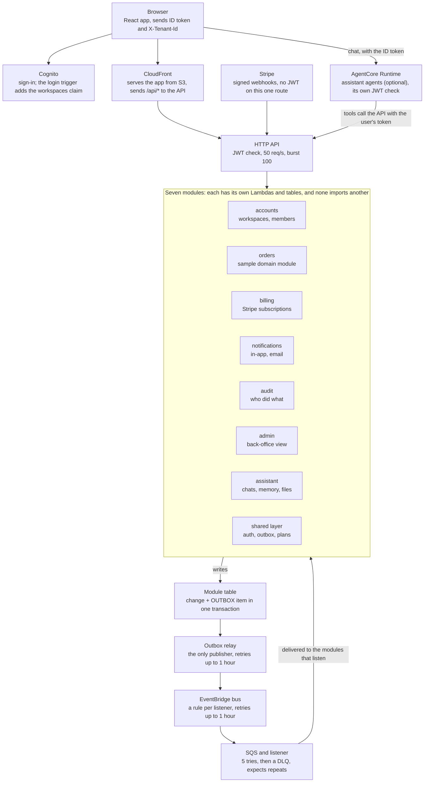

# SaaS Backend v2: Architecture Runbook

Oct 30, 2026

`saas-backend-v2` is a multi-tenant serverless SaaS template on AWS: one SAM template holds 7 modules, 19 Lambda functions and 8 DynamoDB tables. It runs on a dev stack and has never been deployed to production.

This runbook explains how it works, how to change it and what to do when it breaks. It was checked against commit `ffb403e`; the last section lists what passed, what has drifted and what could not be checked. For full detail, read the [README](https://github.com/henryonai/saas-backend-v2/blob/main/README.md), the [data model](https://github.com/henryonai/saas-backend-v2/blob/main/docs/data-model.md) and the [assistant README](https://github.com/henryonai/saas-backend-v2/blob/main/modules/assistant/README.md).

## Architecture at a glance

One SAM stack holds everything, and requests and events take separate paths through it.



The browser reaches the app and its API on one CloudFront address, so there is no CORS. The API's own address also stays open, protected by the JWT check and its throttle; there is no WAF. Stripe and scripts use that address directly.

## Modules

Each module could become its own repository: it owns its tables and never imports another module. Modules learn about each other through the login token, events, and, for the assistant, the public HTTP API called with the user's own token.

| Module | Owns | Runs as | Listens to |
| --- | --- | --- | --- |
| Accounts | Workspaces, members, invitations, export jobs | API, login trigger, hourly purge, worker | `SubscriptionChanged`, `ExportRequested`, `TenantSuspended`, `TenantUnsuspended`, exports bucket "Object Created" |
| Orders | Orders and their counter (the sample to copy) | API, listener | `TenantDeleted`, `ExportRequested`, status events |
| Billing | Subscriptions, through Stripe | API, webhook, listener | `TenantDeleted`, `ExportRequested`, `PlanGranted`, status events |
| Notifications | In-app notifications and email | API, worker | `OrderCreated`, `UserInvited`, `SubscriptionChanged`, `PaymentFailed`, `MemberRemoved`, `TenantDeleted`, `ExportRequested`, `ExportReady` |
| Audit | Who did what in a workspace, kept a year | API, listener | 16 event types (`AuditRule`) |
| Admin | Platform admins' read model of every workspace, and their log | API, listener | 10 event types (`AdminRule`) |
| Assistant (optional) | Conversations, memories, files, usage, agent checkpoints | AgentCore Runtime, API, purge worker | `MemberRemoved`, `TenantDeleted`, `ExportRequested`, status events |

The status events are `TenantSuspended`, `TenantUnsuspended`, `TenantDeletionScheduled` and `TenantRestored`.

**Inside a module.** `api.py` holds routes, `service.py` the rules and `repository.py` the DynamoDB access. `schemas.py` is the HTTP shape, `models.py` what is stored, and `events.py` what other modules see. Only `container.py` reads settings and builds real clients, so tests swap dependencies without patching. The two exceptions are the assistant's key lookup in llm.py and the outbox relay in the shared layer.

**The assistant differs in three ways.**

- It runs on AgentCore Runtime, one microVM per conversation, not on Lambda. Its code ships as a separate zip from scripts/package-assistant.py, which the deploy workflow builds. Chat goes straight from the browser to the runtime, past the HTTP API.
- Its only frontend contract is AG-UI events. Its models come through OpenRouter or Bedrock, chosen by `AssistantModelId` or an agent's own file.
- Its `bash` tool runs in a separate Code Interpreter sandbox, with no AWS role and, by default, no internet (AWS says S3 stays reachable).

## Identity and tenancy

The token decides what a caller may do, and the request only picks one workspace the token already lists. Request bodies never carry a `tenant_id`.

1. A user signs in to Cognito with their email (MFA is optional).
2. At every login and refresh, the login trigger (`accounts/pre_token.py`) adds a `workspaces` claim to the ID token, with the user's role and the plan for each workspace.
3. The browser sends the ID token and an `X-Tenant-Id` header. The assistant uses `forwardedProps.tenantId`, because AgentCore passes on no custom headers.
4. API Gateway's JWT authorizer checks the signature, issuer and audience. It also accepts access tokens, so `get_current_user` refuses any token whose `token_use` isn't `id`.
5. `get_current_user` accepts only a workspace the token lists. Anything else gets 401, and the client refreshes its token and retries.
6. The route checks the role, and the repository builds every key from that tenant id.

ID tokens last 15 minutes and refresh tokens 30 days, so the question for any change is when it takes effect.

| What changed | Where it is enforced | Takes effect |
| --- | --- | --- |
| Role or membership, for accounts' own actions | Accounts re-reads its table | At once in accounts. A role change or removal by someone else also revokes refresh tokens; leaving doesn't |
| Role, in other modules | The token | Within 15 minutes |
| Workspace suspended or being deleted | Accounts' own record; a `STATUS` copy in orders, billing and the assistant | Seconds, as the event arrives |
| Plan | The token | Next token refresh |
| Joined a new workspace | The token | 401 until the client refreshes |

**Three things a reviewer should know.**

- Tenant isolation is enforced in code, by the keys. There is no second IAM layer such as `dynamodb:LeadingKeys`.
- `POST /webhooks/payments` is the only route without a JWT check. It verifies Stripe's signature and a 5-minute timestamp, then fetches the current subscription from Stripe.
- Platform admins are a Cognito group (`platform-admins`), read from `cognito:groups`. Only the admin module's routes accept them.

## Data model and consistency

All workspaces share each table (AWS's pool model), and the key shape keeps them apart. Every table is on-demand with point-in-time recovery, is retained if the stack is deleted, and is deletion-protected in prod.

| Key prefix | Holds |
| --- | --- |
| `TENANT#<tenant_id>` | A workspace's items |
| `TENANT#<tenant_id>#USER#<user_id>` | One user's items in a workspace |
| `USER#<id>` | A user's memberships and exports |
| `EMAIL#` | The invitations index (`gsi1`) |
| `OUTBOX#` | Events waiting to be published, kept 7 days |
| `IDEMPOTENCY#` | Sort key for retried creates (24 hours); partition key for notifications' handled events (7 days) |

These five patterns do most of the work, and each is worth copying.

| Pattern | Problem it solves | How it works | Code |
| --- | --- | --- | --- |
| DynamoDB conditions | Limits broken by concurrent requests | The limit is a condition on the write, never read-then-write | `orders/repository.py` |
| Outbox | A change without its event, or the reverse | The event is saved in the change's transaction, and a relay publishes it | `shared/outbox.py` |
| `Idempotency-Key` | A retried create making a second item | The key is saved in the create's transaction; a retry returns the first result, and a different body gets 400 | `shared/idempotency.py` |
| Status copy | Tokens that still list a suspended workspace | Modules keep `TENANT#<t>` / `STATUS` from events and refuse writes unless active | `shared/workspace_status.py` |
| Repeat-safe listeners | Delivery that is at least once and unordered | Each listener handles repeats its own way: event id, revision, timestamp or idempotent writes. Not all are order-safe (see Verification) | each module's listener |

**How an event travels.**

1. The repository writes the change and an `OUTBOX#` item in one transaction.
2. The table's stream, filtered to new `OUTBOX#` items, triggers `OutboxRelayFunction`, the only function allowed to call `events:PutEvents`.
3. The relay retries a failed record for up to an hour, then reports it to `OutboxDLQ`. The item stays in the table for replay.
4. A rule on the stack's bus sends the event to each listener's SQS queue, retrying for up to an hour.
5. The worker gets 5 tries, then the message goes to that queue's dead-letter queue.

When stored items change shape, the change must say how existing items are read or backfilled. The `scripts/backfill-*.py` and `scripts/migrate-memberships.py` files are the examples.

## Build, test and deploy

A change reaches `main` only through a pull request whose `check` and `web` CI jobs pass, and deploys are started by hand. Run the same checks locally first:

```bash
uv sync --all-packages
uv run pytest
./scripts/export-requirements.sh --check
uvx ruff check .
uvx cfn-lint template.yaml .github/deploy-role.yaml
cd web && pnpm gen:api && pnpm typecheck && pnpm lint && pnpm test && pnpm build
```

`pnpm gen:api` must leave `web/src/shared/api/generated` unchanged. After changing Python dependencies, run `./scripts/export-requirements.sh` and commit the result, because `sam build` installs from those files.

Dev and prod run the same code with different values from `samconfig.toml`.

| Setting | `saas-dev` | `saas-prod` |
| --- | --- | --- |
| State | Deployed | Not deployed yet |
| Deploys from | Any branch, in one run | `main` only, in two runs |
| API rollout | All at once | API functions only: 10% for 5 minutes, then the rest; rolls back on `ApiFunctionErrorsAlarm` or `LambdaThrottlesAlarm` |
| Workspace restore window | 0.001 days (about 90 seconds) | 7 days |
| CORS | Any origin | None; the app calls `/api` on its own address |
| Log retention (dev's assistant runtime logs: 7 days) | 30 days | 90 days |
| Table deletion protection | Off | On |

In prod, the login trigger, workers and relay switch to new code at once. A change that breaks only the login trigger gets no automatic rollback.

**Deploying.** Go to Actions > deploy > Run workflow, then pick the branch and environment. GitHub signs in to AWS with OIDC, so no AWS keys are stored in GitHub.

**Deploying prod takes two runs.**

1. Run the workflow for prod. It creates a CloudFormation change set, lists every change in the run's summary with replacements in bold, and stops.
2. Read the summary, then run it again with *apply* set to the first run's number. It refuses if `main` has moved or a newer run prepared another deploy. A terminal sam deploy has no branch check, so use the workflow.

**Setting up a new copy.**

1. Run `uv run python scripts/rename-project.py acme --title "Acme"`, then `uv sync --all-packages`, and review the diff.
2. Create a deploy role with `.github/deploy-role.yaml`, once per environment, in that environment's account.
3. Create the GitHub environment and set its `AWS_ROLE_ARN` variable to the role's `RoleArn` output.
4. Put the Stripe key in SSM, and the OpenRouter key if you use the assistant. Deploy with the workflow, which also publishes the web app, then run `scripts/stripe-setup.py --stack <stack>`, which also saves the webhook secret. In a new account, the first run skips the assistant's code, so run deploy again to add it.
5. Run `uv run scripts/smoke-test.py --stack <stack>`. It needs a Stripe test key, the published web app and an AWS region set. It creates three test users and calls every endpoint, so use it on dev, not prod.

Email stays off until you set `EmailSender` and `SesIdentity`. Until then app emails, invitations included, are only logged, and Cognito sends about 50 emails a day itself.

**How changes are made here.** This repo builds every change with [Slipway](https://github.com/henryonai/slipway), a separate plan, build, review and land kit configured in `.ship/profile.yaml`. Its hooks refuse commits on `main` and `gh pr merge`, and a change to a sensitive path is reviewed against the profile's security rules. A contributor without Slipway should still follow `AGENTS.md`: write commit messages as one plain imperative sentence, keep docs in step with the code, and put every UI string in both `en.json` and `vi.json`.

## Operating procedures

Start from the alarm or symptom in this table, and use the stack's CloudWatch dashboard (output `DashboardUrl`) for the wider picture. Alarms go to `AlertsTopic`; set `AlertEmail` to receive them by email.

| Alarm or symptom | What it means | Look first | Fix |
| --- | --- | --- | --- |
| `ApiErrorsAlarm` | The API answered 5xx | The access log's `error` field, then `Unhandled error` in the app log group by `correlation_id` | Fix the cause and deploy |
| `ApiFunctionErrorsAlarm` | An API function errored; sends no email | The same logs | During a prod canary it rolls the deploy back |
| `AccountsPreTokenErrorsAlarm` | Sign-ins are failing; Cognito doesn't retry the trigger | The login trigger's logs; a broken shared layer shows here first | Fix and deploy now: nobody can sign in |
| `OutboxLagAlarm` | Events have waited over 5 minutes | `outbox-relay` in the app log group | The relay retries for an hour; fix what blocks it |
| `OutboxDLQAlarm` | A record couldn't be published within an hour | The DLQ message and the relay's warnings | Fix the cause, then run `replay-outbox.py` (below) |
| A module's `*DLQAlarm` | A worker failed 5 times, or a rule couldn't deliver within an hour | The message's `ERROR_CODE` attribute (rule failures only) and the worker's WARNING traceback | Fix the cause, then use SQS "Start DLQ redrive". The assistant's DLQ also holds stream failures, which a redrive can't process |
| `AccountsPurgeDLQAlarm` | A purge run failed | `AccountsPurgeFunction`'s logs | The next hourly run continues; or run it by hand (below) |
| `LambdaThrottlesAlarm` | Lambda throttled a request-path function in this stack; the admin API isn't counted | The dashboard's concurrency and queue graphs | Find what is using it, or ask for a higher limit |
| `ApiDurationAlarm`, `WorkersDurationAlarm` | p99 duration above 80% of the timeout for 15 minutes; audit and admin aren't covered | The alarm's graph, per function | Fix the slow path; if you change a `Timeout`, change it in the alarm too |
| API answers 503 | Transactions keep colliding on one item | Which workspace is busy | The client retries; a create needs the same `Idempotency-Key` |
| 401 "doesn't list this workspace" | The token predates the membership | Nothing to investigate | The client refreshes its token and retries |
| 500 on a query just after adding an index | DynamoDB is still building it | `IndexStatus` is `CREATING` | Wait; it took about 5 minutes on dev |
| First deploy left `ROLLBACK_COMPLETE` | CloudFormation can't update that stack | The stack's events | Delete the stack, then prepare again |

**Routine commands.** Set `AWS_PROFILE` first: a stack with the same name can exist in another account.

```bash
# Publish saved events again (kept 7 days). Dry-run first, with a narrow window
uv run python scripts/replay-outbox.py --table <table> --bus <EventBusName> --since <ISO time> --dry-run

# Run the workspace purge now
aws lambda invoke --function-name <AccountsPurgeFunction name> out.json

# Make someone a platform admin
aws cognito-idp admin-add-user-to-group --user-pool-id <UserPoolId> --username <email> --group-name platform-admins

# Check a deployed stack end to end, on dev
uv run scripts/smoke-test.py --stack saas-dev
uv run scripts/smoke-assistant.py --stack saas-dev   # costs a few cents of model tokens

# Check the assistant's stored data (read-only)
uv run python scripts/check-assistant-data.py --config-env dev
```

**Replay narrowly.** Listeners handle normal repeats, but replaying an old event can undo later changes. A replayed `TenantSuspended` suspends a workspace again, an older `PlanGranted` overwrites a newer plan, and a replayed `MemberRemoved` deletes the memories and files of someone invited back.

**Requests per workspace.** Run this in Logs Insights on the app log group:

```
filter message = "Request" | stats count(*) by tenant_id | sort count(*) desc
```

## Lessons learned

Most of these rules came from something that broke or surprised us on dev, and the commit holds the full story. They apply to most serverless systems, not only this one.

| Lesson | What happened | What the repo does now | Commit |
| --- | --- | --- | --- |
| Failures must leave a trace | A dev review found errors only the logs knew about, and worker failures logged only at DEBUG | Failed messages log a WARNING with a traceback, and every uncaught API error logs one `Unhandled error` line | [23fa3d8](https://github.com/henryonai/saas-backend-v2/commit/23fa3d8) |
| One bad event must not block the rest | A stream record that kept failing could hold up its shard for a day | Records retry for one hour, then go to a DLQ, and stay replayable | [0c3522b](https://github.com/henryonai/saas-backend-v2/commit/0c3522b) |
| Tokens lag behind reality | A suspended workspace stayed in tokens for up to 15 minutes | Modules keep a status copy from events and refuse writes at once | [621aa60](https://github.com/henryonai/saas-backend-v2/commit/621aa60) |
| A retry must not create twice | A timeout or double click could make a second order or workspace | `Idempotency-Key` is required and saved in the create's transaction | [63e55dd](https://github.com/henryonai/saas-backend-v2/commit/63e55dd), [4968251](https://github.com/henryonai/saas-backend-v2/commit/4968251) |
| Limit background concurrency | A backlog or DLQ redrive could use the concurrency the API and login need | Accounts and notifications workers run at most 5 at a time, and later listeners at most 2 (`MaximumConcurrency`) | [77260e6](https://github.com/henryonai/saas-backend-v2/commit/77260e6) |
| Measure before adopting a managed service | AgentCore Memory checkpoints were 49 times the chat's size (2.7 MB against 53 KB) and added about a second per answer | Checkpoints moved to a DynamoDB table | [fb0f2d9](https://github.com/henryonai/saas-backend-v2/commit/fb0f2d9) |
| A new index isn't ready when the deploy ends | Queries on the index answered 500 for about 5 minutes while it was built | The README warns of it. A later change added the new index first and dropped the old one in another deploy, because CloudFormation changes one index per update | [5764174](https://github.com/henryonai/saas-backend-v2/commit/5764174), [ea9fbe8](https://github.com/henryonai/saas-backend-v2/commit/ea9fbe8) |
| Save first, then stream | A reload lost track of an answer in progress | The message and its run are saved first, and a reload reconnects to the stream | [febe134](https://github.com/henryonai/saas-backend-v2/commit/febe134) |
| Check that Stop really stops | Closing the stream waited for the running step, so a long answer kept being written and billed | Stop ends the model's call and keeps what the user saw | [a82b0fc](https://github.com/henryonai/saas-backend-v2/commit/a82b0fc) |
| Tracing can leak data and fail quietly | Traces were dropped until an account setting was on, and instrumentation logged model messages to a separate log group | A script turns on the setting, and conversations stay out of prod's logs | [31544b3](https://github.com/henryonai/saas-backend-v2/commit/31544b3) |
| Read the real OIDC subject | The first deploy was refused because the repo's tokens use immutable ids, not `repo:owner/name` | The role takes the prefix GitHub reports, so a renamed repo can't take it over | [0679f1c](https://github.com/henryonai/saas-backend-v2/commit/0679f1c) |
| Keep templates free of personal values | A prod alert address in the template would have reached every copy | Values are empty placeholders, and the rename script checks for leftovers | [77260e6](https://github.com/henryonai/saas-backend-v2/commit/77260e6), [d5367ea](https://github.com/henryonai/saas-backend-v2/commit/d5367ea) |

**A gap we know about.** The assistant's tests use scripted fake models, so they prove the code works but not that the answers stay good. A regression in answer quality would reach users first; `plans/BACKLOG.md` holds the proposed fix.

## Verification

The code and the dev stack match this runbook, but the production path has never run, the README has drifted in small ways, and a few alarm and event-ordering gaps remain. All of this was checked on 30 October 2026 at commit `ffb403e`.

| Checked | How | Result |
| --- | --- | --- |
| Backend tests | `uv run pytest` | 372 passed |
| Backend lint and templates | `ruff`, `cfn-lint`, `export-requirements.sh --check` | All passed |
| Web app | `gen:api`, typecheck, lint, tests, build | Generated client unchanged; 130 tests passed; build succeeded |
| Branch protection | GitHub API | Pull request required; `check` and `web` required; applies to admins |
| Template contents | Parsed `template.yaml` | 19 functions, 8 tables, 16 queues, 16 alarms, 8 event rules, as described here |
| Module boundaries | Searched non-test code | No module imports another; settings are read only in `container.py` and `settings.py` |
| IAM | Read each function's policies | Only the relay can publish events; each function names only its own module's tables; only the webhook function can read the webhook secret |
| Live dev stack | Read-only AWS calls | `UPDATE_COMPLETE`, deployed 30 October; 16 alarms, none firing |
| Assistant data on dev | `check-assistant-data.py` | Passed, but the table is empty, so it proves little |
| Prod | Read-only AWS call; GitHub deployments | No `saas-prod` stack; no deployments to the prod environment |

**Not checked.**

- The smoke tests were not run for this review, because they create users and spend money.
- The two-run prod deploy and the canary rollback have never run against a production stack.
- Live Stripe mode, SES email and behavior under load have not been tested.

**Corrections still to make.** None of these changes behavior.

- [ ] The README's opening and the template's `Description` leave out audit and admin; the template's also leaves out the assistant.
- [ ] A paragraph about the audit log splits the README's events table, leaving the `SubscriptionChanged` and `PaymentFailed` rows outside it.
- [ ] That table lists too few listeners: for example, admin also takes `OrderCreated`, `SubscriptionChanged` and `MemberRemoved`.
- [ ] The README's dead-letter list omits audit and admin, and its worker limits omit orders, audit, admin and billing, which run 2 at a time.
- [ ] The README's layout omits `shared/idempotency.py`, `shared/workspace_status.py`, `scripts/smoke-assistant.py` and `scripts/backfill-workspace-status.py`.
- [ ] The README mentions only the billing API reading the Stripe key; the webhook and listener can too. The assistant README still describes the removed gsi1 index.
- [x] "Starting a new project" said to create the webhook secret before deploying, but the README gave no command, and `stripe-setup.py` writes it after the deploy. Fixed in PR #45.
- [ ] The README says dev and prod share one account by default, while this repo's own stacks use one account per environment.
- [ ] `plans/` describes a plan per change, but its index is empty and no `plan.md` is in git history, so the reasoning lives only in commit messages.

**Gaps in the system.** These do change behavior, and none has been fixed.

- [ ] `LambdaThrottlesAlarm` omits `AdminApiFunction`, although that function's canary rolls back on the alarm.
- [ ] `ApiDurationAlarm` and `WorkersDurationAlarm` omit the audit and admin functions.
- [ ] No alarm watches the AgentCore runtime, so `ApiErrorsAlarm` misses chat failures there.
- [ ] `scripts/replay-outbox.py` says replaying more than needed is safe, which the three cases under Operating procedures contradict.
- [ ] Accounts' suspend and unsuspend have no ordering, so an unsuspend arriving before its suspend leaves the workspace suspended.
- [ ] Billing's `PlanGranted` has no time check, so a late or replayed grant overwrites a newer one.

**Settled since.** When this was checked, `LICENSE` said all rights reserved while the README said to use the repository as a template. It is now MIT-licensed, so readers may copy it as long as they keep the notice.
